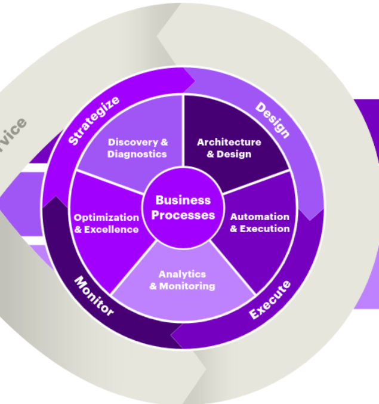

# BPMN Workshop Research Notes

*Part 1: What BPMN is, why it is used, its alternatives, and its benefits and drawbacks for a software engineering audience*

Romain · BPMN for IT Process Design workshop · September 2026

> Merged from `BPMN_Workshop_Research_with_citations.docx` (GitHub, the cited version) and the research part of `BPMN Workshop Plan.docx` (OneDrive, which added sections 0, 7 and 8 plus review comments). `Reasearch for workshop.docx` was an uncited earlier copy of sections 1–5 and is fully contained here. Sections 9 and 10 are new and back the introduction slides.

## 0. Intro: why should students care?

Open with a question instead of a definition: *how would you try to understand a company's process problem, or bring a company's processes into the cloud or a new ERP?* Collect answers, then show that every answer needs a shared way to write the process down and check it with the people who do the work. (Slide 2 of the deck.)

## 1. What BPMN is

BPMN, Business Process Model and Notation, is a graphical standard for describing how a process actually runs: which steps happen, in what order, who is responsible for each one, and where decisions or parallel work occur. It was developed by the Business Process Management Initiative and has been maintained by the Object Management Group since 2005; BPMN 2.0 is also published as ISO/IEC 19510 [1], [2], [3]. The point of standardising it was to stop every consultancy and every tool vendor from drawing process diagrams with its own private set of shapes, which made diagrams impossible to exchange or compare [4].

A BPMN diagram is built from a small set of element types: events (circles) mark things that start, interrupt or end a process; activities (rounded rectangles) are the actual work; gateways (diamonds) are decision or split/merge points; and pools and lanes partition the diagram by participant or team, so a handoff between support and development is drawn, not implied [1], [4]. Jonathan's part of the workshop covers this notation in more depth.

## 2. Purpose, and why companies use it

BPMN exists to close a specific gap: the same process is usually described three different ways by three different people a business analyst's requirements document, a developer's implementation, and whatever the person actually doing the work has in their head. BPMN is designed to be readable by all three without translation [4]. That is the reason it gets adopted: not because companies enjoy drawing diagrams, but because a shared, unambiguous picture of a process is what lets a change to it be discussed, agreed and then built, instead of getting reinterpreted at each handoff.

In practice this shows up as three recurring uses. Companies model an existing process to find where it is slow or unclear before touching it (this is exactly what Part 3 of our workshop asks each group to do). They model a target process as a specification that a development team then builds against, which is closer to how BPMN gets used on an internal automation project. And, where the tooling supports it, they run the diagram directly as an executable workflow, which is the use case that makes BPMN specifically relevant to software engineering [1], [5].

## 3. Why this matters specifically for software engineers

In execution engines such as Camunda 7 or Zeebe (the engine behind Camunda 8), a BPMN 2.0 diagram isn't just documentation that a developer later rebuilds in code somewhere else the file itself is the thing that runs [5].

There's no translation step, no "now let's go implement what this diagram shows." The diagram the business analyst drew and the process actually running in production are literally the same file. So in our exercise, when a gateway decides whether a bug gets sent back to development or pushed on to release, that's not a note buried in a ticketing tool's settings it's the real routing logic, right there in the diagram.

The other reason this is worth knowing as a developer: BPMN comes with a set of already-solved answers to problems every workflow eventually runs into. Need two things to happen at once and wait for both to finish?

That's a parallel gateway. Need to react if something takes too long? Timer event. Need to catch a failure without the whole process crashing? Error boundary event [5], [6]. Teams that build this kind of logic by hand in their own code tend to end up reinventing it clumsily over time [5].

A BPMN engine gives it to you out of the box, and it also keeps that orchestration logic separate from the actual services doing the work which is exactly why BPMN has caught on as a way to coordinate microservices without hard-wiring them to call each other directly [5]. Even if you never touch a BPMN tool again after this workshop, that's a habit worth keeping: keep the "who does what, in what order, what happens if it fails" logic separate from the code that does the actual work [6].

## 4. Alternatives to BPMN

BPMN is not the only way to draw a process, and it is worth being honest about when something simpler is actually the better choice. The table below compares the notations most likely to come up, judged specifically against a software/IT process with parallel work and multiple teams the kind our workshop uses rather than against BPMN in general.

|  |  |  |  |
| --- | --- | --- | --- |
| **Notation** | **Built for** | **Weak point in a software context** | **Fit vs. BPMN** |
| Flowchart | Any linear procedure, no formal rules | No native way to show parallel work, handoffs between teams, or timeouts exactly what our IT process needs [7], [8] | Too weak |
| UML Activity Diagram | Describing control flow inside a system, for a developer audience | Reads as internal program logic, not as something a support agent or a client can follow; no data/message flow between participants [7], [9] | Overlaps, narrower audience |
| EPC (Event-driven Process Chain) | SAP/ARIS-style process documentation | Strict alternating event–function chain makes concurrent branches (dev + QA running in parallel) clumsy; mostly a legacy, licensed-tool ecosystem [10] | Largely superseded by BPMN |
| Petri nets | Formal, mathematically verifiable modelling of concurrency | Rigorous but not legible to a non-specialist; nobody hands a Petri net to a product owner [11] | Too formal for communication |
| Data Flow Diagram (DFD) | Tracing how data moves between stores and processes | Says nothing about sequence, decisions, or who does what not a process model at all [7] | Different purpose entirely |

The short version: a flowchart is the right tool when a process genuinely has no branches or handoffs worth showing, and reaching for BPMN there is over-engineering the diagram. A UML activity diagram is the right tool when the audience is exclusively developers and the goal is describing what a system does internally, not what an organisation does across teams. BPMN earns its place specifically when a process crosses team or system boundaries and that crossing is the part worth showing which describes our Part 2 exercise exactly [7], [9].

## 5. Benefits and drawbacks

Neither list below is theoretical; both come directly from how BPMN behaves once a team actually starts using it, not from a features comparison.

|  |  |
| --- | --- |
| **Benefits** | **Drawbacks** |
| One ISO standard (ISO/IEC 19510), so a diagram made in Camunda Modeler can be exported as standard BPMN 2.0 XML and opened in other compliant tools [1], [2] | Full symbol set is large; a diagram that uses every gateway type is harder to read than the process it describes [8], [12] |
| Same diagram serves the business analyst, the developer and the end user removes the “translation” step between a requirements doc and a technical spec [4] | No Business Process Management System implements the full BPMN 2.0 specification, so “executable” models still need per-engine adjustment [12] |
| BPMN 2.0 files are XML the diagram is the source code. Engines such as Camunda or Zeebe run it directly, with no separate implementation step [5] | Editing a large diagram is riskier than editing code: a moved gateway can silently change the logic, and diff/version-control tooling is far weaker than for text [12] |
| Ships proven concurrency and error-handling patterns (parallel gateways, timers, boundary/error events) that most teams would otherwise reinvent in application code [5], [6] | Assumes a structured process with a clear start and end; unstructured, case-by-case work (e.g. ad hoc investigation) does not map onto it well [8] |
| Encourages separating the happy path from exception handling, which tends to produce cleaner, more maintainable workflow code [6] | Genuinely takes time to learn well reading a complex diagram correctly is closer to reading unfamiliar code than to reading a flowchart [12] |

## 6. BPMN in practice: three companies

The three companies below come from three different sectors, but all of them run their BPMN models on the Camunda engine. That makes them good illustrations of section 3: in each case the diagram is the workflow that actually executes in production, not documentation drawn after the fact.

**Zalando (e-commerce, Germany).** The Berlin-based online fashion retailer uses BPMN on Camunda to orchestrate its sales order process: everything that happens in the back end after a customer places an order, through to its 11 fulfilment centres in seven European markets. The platform serves around 42 million active customers in 20 markets. Zalando chose BPMN because the diagrams are readable by both engineers and domain owners, because binding the diagrams to the source code made changes simpler, and because the engine scales to peak periods such as Black Friday [13]. Use case: high-volume order orchestration.

**Deutsche Telekom (telecommunications, Germany).** Deutsche Telekom IT, the group’s internal IT provider with about 9,700 employees, replaced a monolithic Oracle BPEL system that had been in place since 2007 with Camunda engines running inside many microservices that talk to each other through a message broker. Camunda also became the orchestration layer over roughly 3,000 RPA bots, so process logic that spans bots, APIs and people is visible in one BPMN model. The company reports faster time-to-market, one shared modelling language for business and development teams, and real-time visibility of running processes [14]. Use case: microservice and RPA orchestration.

**Jyske Bank (banking, Denmark).** Jyske Bank uses BPMN to run its Know Your Customer (KYC) compliance process in three parts: updating data on existing customers, routing new customers through KYC checks according to their profile, and the periodic KYC reviews that regulators require. The models combine automated steps, manual user tasks, timers and compliance deadlines across several teams, for hundreds of thousands of customers. The bank reports that employees save up to 80% of the time previously spent on these manual tasks, and that parts of the processes can be reused in new process solutions [15]. Use case: long-running, regulated processes with timers and human tasks.

Taken together, the three cases line up with the arguments in section 3: Zalando shows the diagram running at high volume, Deutsche Telekom shows BPMN coordinating microservices without hard-wiring them, and Jyske Bank shows timers and human tasks handled by the engine instead of by hand.

## 7. When to use BPMN / how you will see it in the real world

BPMN is most helpful in large projects where processes become too complex for one person to keep in their head. BPMN then makes these processes visible so people can communicate about them.

For fresh graduates it is worth learning because programmers go into every industry and need to adapt to processes in domains they do not yet understand well.

A good example is a consulting firm such as Accenture helping a large client optimise a process. Such a project is split into several stages [16]:

For a smaller project a UML diagram may be enough, and it can even make sense for more complicated small projects. BPMN is used for the higher level of abstraction needed to align stakeholders [17].

## 8. How you will use it in a company after graduating

Companies use BPMN to model business processes visually and create a common language between business users, analysts, developers and process managers [1].

When an ERP is used to move processes into software, the person setting up the business rules can consult the BPMN diagrams. The BPMN model could, for example, specify the amount above which an employee needs the manager's approval; requests below that amount are approved automatically by the ERP.

SAP's Best Practice processes are themselves published as BPMN flow diagrams in SAP Signavio Process Navigator, downloadable as `.bpmn` files [20]. Process modelling is also one of the core business-analysis techniques in the IIBA BABOK Guide v3 (§10.35) [21].

## 9. Why this is specifically an enterprise problem

The communication gap BPMN addresses is small in a pizzeria and large in an enterprise. Three things make the difference:

- **Many systems.** Organisations now use on average about 50 endpoints (systems, APIs, bots, people) to execute process tasks, 19% more than five years earlier [19]. 51% of respondents see more complexity because processes span multiple systems, up from 45% in 2023, and 39% say legacy systems are hard to connect [18].
- **Many stakeholders.** 58% see a disconnect between IT decision-makers and business leaders around their processes [18]. In the Orbitask case a single customer touches sales, customer success, finance, support and development.
- **High complexity.** 82% of large organisations fear “digital chaos” from increasingly complex, interconnected and automated processes [19]; 56% have a lot of automation in place but no good way to control it all [18].

Side note: despite increased investment, the share of automated organisational processes went *down* from 52% (2023) to 50% (2024) [18]. Automating without a shared understanding of the process does not pay off by itself.

## 10. Notation subset needed for the exercises

Real-world models use a small part of BPMN: in a study of 120 models the average model used about 9 distinct constructs, and fewer than 20% of the vocabulary was used regularly [22]. The Orbitask as-is models use a similarly small subset, so the notation walkthrough (slides 12–24) focuses on these:

| Group | Elements used in the Orbitask models |
| --- | --- |
| Events | start, message start, timer start, intermediate message (wait for a message), intermediate timer (wait for a time), end |
| Activities | task with markers: user, manual, send, receive, service (service = automated, used in the to-be) |
| Gateways | exclusive (XOR), parallel (AND) |
| Swimlanes | pools (including collapsed “black box” pools for customers and suppliers), lanes |
| Connecting objects | sequence flow, message flow, association |
| Artifacts | text annotations (in Orbitask: the known problems, with figures) |

## Open review comments from the OneDrive version

These were inline comments in `BPMN Workshop Plan.docx`; kept here so they can be resolved.

- Section 1: “source?” on the standardisation claim (now cited [1]–[4]); “i like the overview” on the element summary.
- Section 3: “these engines are somewhat of a new development. doesnt have too much to do with the point above, but in general good point given the audience is more software focussed.” Note: the OneDrive draft listed draw.io as an engine. draw.io is a modelling tool, not an execution engine; the cited version lists only Camunda 7 and Zeebe. List of engines: <https://en.wikipedia.org/wiki/List_of_BPMN_2.0_engines>. Also: “this is basically systems thinking.”
- Section 4: “ask students for more and probably we can come up with more too”; ask students for an example each for flowchart, UML and BPMN; “is there something even more high level?” (Deck slides 8–9 now have questions for the room.)
- Section 5: “should elaborate more on this”, “everything sounds like chatgpt”, “and it needs to be interactive. we cant just present something. need to ask questions, do brainstorming, etc.” (Every intro slide now has a question for the room; see the speaker notes and [talk-track.md](talk-track.md).)

## References

[1] Object Management Group, “Business Process Model and Notation (BPMN), Version 2.0.2,” OMG, 2014. [Online]. Available: https://www.omg.org/spec/BPMN/

[2] ISO/IEC 19510:2013, Information technology — Object Management Group Business Process Model and Notation. Geneva, Switzerland: ISO, 2013. [Online]. Available: https://www.iso.org/standard/62652.html

[3] Trisotech, “BPMN introduction and history,” Aug. 11, 2015. [Online]. Available: https://www.trisotech.com/bpmn-introduction-and-history/

[4] C. Stryker and I. Belcic, “What is Business Process Modeling and Notation (BPMN)?,” IBM Think, 2024. [Online]. Available: https://www.ibm.com/think/topics/bpmn

[5] Camunda Cloud Team, “BPMN and microservices orchestration, Part 1 of 2: Flow languages, engines, and timeless patterns,” Camunda Blog, Aug. 1, 2018. [Online]. Available: https://camunda.com/blog/2018/08/bpmn-for-microservices-orchestration-a-primer-part-1/

[6] Django Viewflow, “5 lessons that software developers can learn from Business Process Model and Notation (BPMN),” Medium, Mar. 1, 2021. [Online]. Available: https://viewflow.medium.com/5-lessons-that-software-developers-can-learn-from-business-process-model-and-notation-bpmn-ed7500fc3022

[7] C. Green, “Alternatives to Business Process Modelling Notation (BPMN),” Netcall Blog, Jan. 23, 2024. [Online]. Available: https://www.netcall.com/blog/alternatives-to-business-process-modelling-notation-bpmn/

[8] H. Magalhães, “What are the advantages and disadvantages of choosing BPMN instead of a traditional flowchart?,” Helppier, Dec. 7, 2023. [Online]. Available: https://www.helppier.com/en/advantages-and-disadvantages-bpmn-traditional-flowchart/

[9] Visual Paradigm Guides, “A comparative analysis of activity diagrams and BPMN in UML.” [Online]. Available: https://guides.visual-paradigm.com/a-comparative-analysis-of-activity-diagrams-and-bpmn-in-uml/

[10] A.-W. Scheer, O. Thomas and O. Adam, “Process modeling using event-driven process chains,” in Process-Aware Information Systems, M. Dumas, W. M. P. van der Aalst and A. H. M. ter Hofstede, Eds. Hoboken, NJ, USA: Wiley, 2005. doi: 10.1002/0471741442.ch6

[11] W. M. P. van der Aalst, “The application of Petri nets to workflow management,” Journal of Circuits, Systems and Computers, vol. 8, no. 1, pp. 21–66, 1998.

[12] Y. Kologryvov, “What’s wrong with BPMN?,” Medium. [Online]. Available: https://medium.com/@yaroslavkologryvov/whats-wrong-with-bpmn-0f948c5c9391

[13] Camunda, “How Zalando orchestrates its sales order process with Camunda,” Camunda Blog, Jul. 2021. [Online]. Available: https://camunda.com/blog/2021/07/how-zalando-orchestrates-its-sales-order-process-with-camunda/

[14] Camunda, “Deutsche Telekom moves to microservices,” Camunda case study. [Online]. Available: https://camunda.com/case-study/deutsche-telekom/

[15] Camunda, “Jyske Bank increased customer satisfaction using Camunda,” Camunda case study. [Online]. Available: https://camunda.com/case-study/jyske-bank/

[16] Accenture, “Business Process Management” infographic. [Online]. Available: https://www.accenture.com/content/dam/accenture/final/a-com-migration/manual/r3/pdf/Accenture-BPM-Infographic.pdf

[17] Miro, “BPMN vs. UML.” [Online]. Available: https://miro.com/de/diagramm/bpmn-vs-uml/

[18] Camunda, “Camunda survey shows automation growth remains flat despite increased investment” (State of Process Orchestration 2024; 866 respondents at companies with 250+ employees, fielded Sep. 20–Oct. 4, 2023), press release, Jan. 16, 2024. [Online]. Available: https://camunda.com/press_release/camunda-survey-shows-automation-growth-remains-flat-despite-increased-investment/

[19] Camunda, “8 in 10 organizations fear digital chaos as business process complexity increases” (State of Process Orchestration & Automation 2025; 800 respondents at organisations with 1,000+ employees, fielded Sep. 30–Oct. 28, 2024), press release, Jan. 22, 2025. [Online]. Available: https://camunda.com/press_release/8-in-10-organizations-fear-digital-chaos-as-business-process-complexity-increases/

[20] SAP Community, “Using SAP Best Practices packages with SAP Signavio,” 2022. [Online]. Available: https://community.sap.com/t5/technology-blog-posts-by-sap/using-sap-best-practices-packages-with-sap-signavio/ba-p/13537457

[21] IIBA, *A Guide to the Business Analysis Body of Knowledge (BABOK Guide)*, v3. Toronto: IIBA, 2015, §10.35 Process Modelling.

[22] M. zur Muehlen and J. Recker, “How much language is enough? Theoretical and practical use of the Business Process Modeling Notation,” in *Proc. CAiSE 2008*, LNCS 5074. Berlin: Springer, 2008, pp. 465–479. doi: 10.1007/978-3-540-69534-9_35
