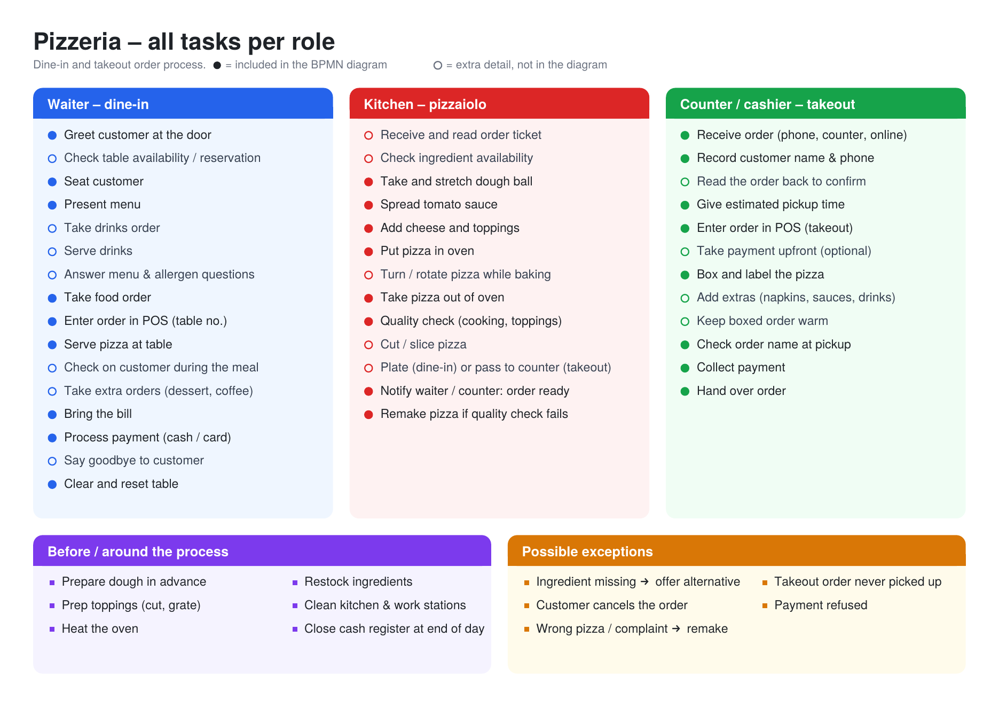

# BPMN Workshop Plan

> Converted from `BPMN Workshop Plan.docx` (OneDrive version, Nov 2026). The research notes that were in the second half of that document are in [research-notes.md](research-notes.md).

Team SharePoint: <https://stichtingfontys.sharepoint.com/sites/ESD-BPMNGroup/Gedeelde%20documenten/Forms/AllItems.aspx?id=%2Fsites%2FESD-BPMNGroup%2FGedeelde%20documenten%2FGeneral&viewid=0d5e7c32-affb-4f7c-8775-4e738c817c6d>

This workshop is about teaching a crucial Business IT Topic of the Business Process Modeling Notation (BPMN): BPMN is basically a **standard notation to draw how a business or IT process works**, similar to a flowchart but with agreed rules and symbols. The workshop teaches software-oriented participants how to use BPMN to describe processes clearly enough that both technical and non-technical teams can understand them. The topic is explained on a theoretical level, applied in a multitude of cases in small groups and finally wrapped up in a presentation of the group's solutions.

You are already familiar with modeling from other courses like UML for planning and communicating larger software projects. Now imagine even one stage more abstract. a process planning that can show not just a single software. But rather a companies processes visualized like a class diagram

The workshop has three stages:

1. **Learn the basics.** Introduce what BPMN is, why companies use it, and the main diagram elements: steps/tasks, start and end events, decisions, parallel activities, team responsibilities, and communication between teams. Show tools such as Camunda Modeler or draw.io and walk through a simple IT example like resolving a support ticket or handling a deployment request.
2. **Practice modeling a simple process.** Small groups receive the same short software process, for example: a user reports a bug → support checks it → development fixes it → QA tests it → it gets released. Each group turns that description into a BPMN diagram. They present their diagrams and score each other on correctness, clarity, and logical flow. The instructor then corrects the strongest example with the class and creates a shared “reference” version.
3. **Use BPMN to improve a process.** Everyone starts with a slightly more complicated version of the same process that contains an obvious problem, such as a slow manual handoff or bottleneck. Each group gets a different improvement goal—for example adding AI automation, improving documentation, reducing response time, or improving communication between teams. They redesign the process and explain what they changed and why.

### **Workshop Structure: BPMN for IT Process Design**

#### **Part 1 : BPMN Fundamentals**

Slide deck covering:

**Romain**

- What is BPMN, what is it’s purpose in business, why companies use it, what are alternatives
- Benefits and drawbacks

> Slides 1–11 of `BPMN Workshop.pptx`; speaker notes in [talk-track.md](talk-track.md), background in [research-notes.md](research-notes.md).

**Jonathan**

- Core notation (3 minutes) so they understand the handout

> Slides 12–33 of `BPMN Workshop.pptx`: handout walkthrough with an example per part, an IT example to read together, quick check, as-is/to-be, choreographies, and the tool showcase (draw.io, Camunda Modeler/bpmn.io, Visual Paradigm, Netcall UPN, drafting with Claude). Notes and sources in [notation-and-tools.md](notation-and-tools.md).
- Showcase Tools: Camunda Modeler, [draw.io](http://draw.io), visual paradigm

#### **Part 2 : Guided Modeling Exercise 1**

Materials: pen papers, 6 differents cheat sheets [BPMN Notation](https://stichtingfontys.sharepoint.com/sites/ESD-BPMNGroup/Gedeelde%20documenten/General/references/cheat-sheet.pdf?TeamsCID=5d56ba11-46d3-45f2-ad46-1c4cad276f34) printed , printed version of the correct way (kept privately, not in this public repo), list of different activities in a pizzeria

Preparation: hand out the printed cheat sheet and the written task, divide the class into groups of 4 people.

Timeplan approximate to gauge progress: 5 minutes to make the list, 10 minutes to make the diagram

Task: make by hand a bpmn of a pizzaria.

1. First, think about how a pizzaria works. Figure out the process they run from an order to the finished product. consider they server both dine in and take out. You can write in text the process
2. Make this process into a BPMN.

   

Example BPMN: kept privately (not in this public repo), shown on the "Compare" slide after the exercise.

#### **Part 3 : Unguided Optimization Challenge** 

Goal: Have students apply the learned. In a complex Process optimisation case.

> Implemented as the **Orbitask** Docker app: each group gets one of 7 manager tickets and the as-is BPMN models of the fictional SaaS company in draw.io. See [`orbitask-workshop/README.md`](../orbitask-workshop/README.md).

#### **Part 4: Discussion about Part 3**

We compare the different results from the different groups and everybody shows what they did, ho wit improves the company and maybe some trade offs they had to make.

Other groups can also say if they would improve something more.

Finally there can be a group discussion of how to combine everything into the “perfect onlineshop” (refer to epreneur stuff like assortment planning, delivery optimization, omnichannel, SEO)

---

## Appendix: content only in the older "ESD Workshop Topic Ideas" draft

Kept here so nothing from the GitHub version is lost.

The **theoretical part** ensures that students understand the value of the topic and how to apply it. The **practical part** ensures that they will know what people are referring to when they talk of a business process in a future job. The **group** **presentations** **and checking** ensures interactivity and that everybody takes away some information.

### Earlier Part 2 variant (bug-ticket process with peer grading)

**Goal:** get everyone comfortable drawing correct BPMN before adding complexity. This is a group exercise. This is a rather simple example from an IT context (e.g., "incident ticket resolution," "deployment request") Should have a clear thing that can be improved in the process.

The purpose of this part is for them to see how to find issues and create concrete improvements based on a diagram.

1. Give every group the *same* short written process (e.g., "a user reports a bug → support triages it → dev fixes it → QA validates → release"). Keep it simple : 5–7 steps, one decision point.
2. Groups (3–4 people) draw it as a BPMN diagram (paper, whiteboard, or the tool from Part 1).
3. Each group presents their diagram (2–3 min each).
4. **Peer grading:** give every group a simple scoring sheet (notation correctness, clarity, logical flow : 3–4 criteria, 1–5 scale) to score the *other* groups while they present.
5. You pick/reveal the best-scored diagram, then correct it live with the class : turning it into a shared reference model everyone can compare against.
